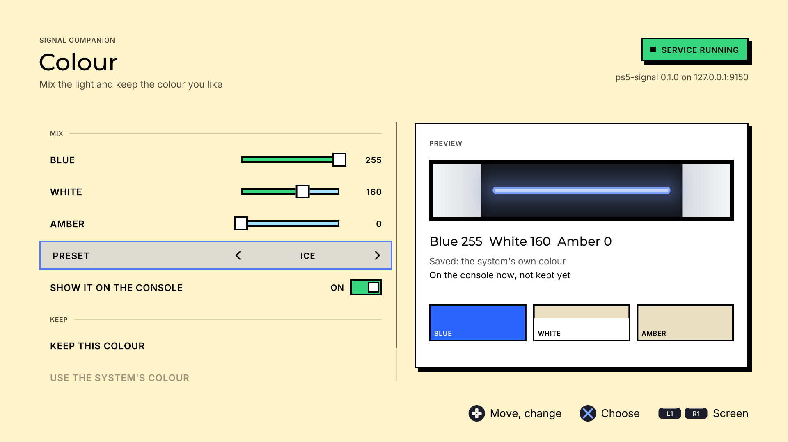
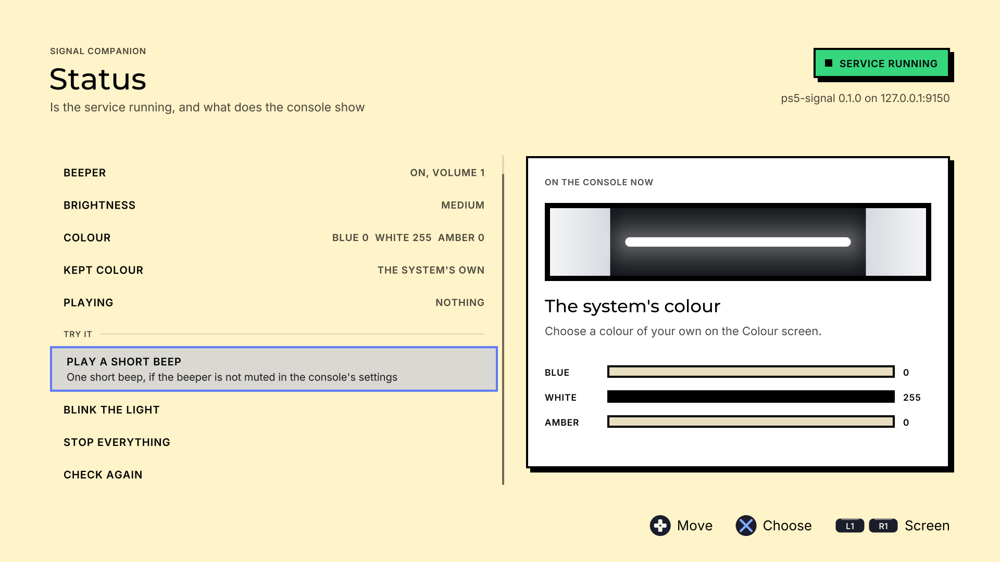
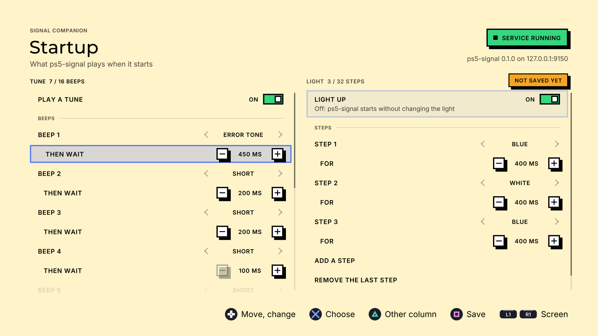

# Signal Companion

A PS5 homebrew app (PPSA69426) for [ps5-signal](https://github.com/Marice/ps5-signal), the background service
that plays beeps and light patterns on the console. With this app you choose the colour of the console's light
and edit the tune and light that ps5-signal plays when it starts.

Tested on 13.60fw on a PS5 PRO



## Quick start

1. **Install Signal Companion:** from the homebrew store, or unzip the
   [release](https://github.com/Marice/ps5-signal-companion/releases/latest) and copy the `PPSA69426` folder to
   `/data/homebrew/` on the console (FTP).
2. **Open it.** When ps5-signal is not running, a dialog asks to start it. Choose **Start it**: the app sends the
   ps5-signal it carries to etaHEN's ELF loader, and you hear its startup tune.
3. **Start it with every boot (optional):** on the Status screen, switch on **Start with ps5-autoloader**. ps5-signal
   then loads last in ps5-autoloader's list. This needs [ps5-autoloader](https://github.com/itsPLK/ps5-y2jb-autoloader) by itsPLK, and etaHEN's "Allow /data
   in sandbox".
4. **Choose your colour and tune:** **Colour** → *Keep this colour*; **Startup** → Square saves the tune and the
   light show.

**Updating:** install the new version of the app and choose **Restart ps5-signal** on the Status screen. With
ps5-autoloader, switch **Start with ps5-autoloader** off and on once, so its copy of ps5-signal is replaced too.

## What you need

- A PS5 that runs homebrew apps (for example with etaHEN).
- ps5-signal running on the console. The app talks to it on `127.0.0.1:9150` and does nothing by itself. When
  it does not run, the app can start it: it carries ps5-signal.elf and sends it to etaHEN's ELF loader.

## Using it

1. Start ps5-signal: send `ps5-signal.elf` to your ELF loader (etaHEN: port 9021), or let your autoloader load it.
   Or open the app first: when the service does not answer, it asks whether to start it for you.
2. Open Signal Companion. **L1** and **R1** move between its three screens; the **touchpad** explains the screen
   you are on.

| Screen | What it does |
| --- | --- |
| **Status** | Says whether ps5-signal runs and what the console shows: the beeper, the light's brightness and colour, the kept colour. Plays a short beep or blinks the light as a test. When the service does not run, a dialog offers to start it ("Start ps5-signal" sends the bundled ps5-signal.elf to `127.0.0.1:9021`); the screen checks again every 3 seconds. "Restart ps5-signal" loads the version in the app after an update. When ps5-autoloader's list can be read, "Start with ps5-autoloader" puts ps5-signal last in it (3 s after the payload before it), or takes it out. |
| **Colour** | Three sliders (blue, white, amber) and presets. With "Show it on the console" on, the light follows the sliders (at most twice a second). "Keep this colour" saves it, so ps5-signal sets it at every start; "Use the system's colour" lets the console decide again. "My colours" keeps up to 6 mixes of your own in the app. |
| **Startup** | The tune (up to 24 beeps: a tone and the wait until the next, the waits 10 seconds at most in all) and the light (up to 24 steps: a colour or a brightness and how long it shows, 10 seconds at most in all) that ps5-signal plays when it starts. A timeline above each shows them; while one plays, a cursor runs along it. Triangle changes column, Square saves both. |

The light has blue, white and amber LEDs only. Mixing them gives other shades; there is no free RGB colour.

<p>


</p>

### What it changes

- **The light, while you try a colour:** `POST /color`. Not saved; "Stop trying" shows the saved colour again.
- **`/data/ps5-signal/config.json`, when you save:** `PUT /config`. The Colour screen changes only `led_color`
  and the Startup screen only `startup`; the other part is sent back as the service had it.
- **`/download0/hui/colours.json`** in the app's own storage: your colours under "My colours".
- **ps5-signal.elf to `127.0.0.1:9021`**, only when you choose "Start ps5-signal" or "Restart ps5-signal".
- **`/data/ps5_autoloader/autoload.txt` and a copy of ps5-signal.elf next to it**, only when you switch on "Start
  with ps5-autoloader". The app reaches `/data` only when etaHEN allows it in the sandbox; otherwise the switch is
  not shown.

The rules for the values (6 beeps per test, 100-2000 ms between beeps, 250-10000 ms per light step and so on)
are the service's own; the app keeps you inside them.

## Building

You need Linux or WSL with Docker.

```sh
docker build -t signal-companion-build docker   # once
docker/run.sh "make deps"                       # once: the PS5 SDKs into .deps/
tools/bundle-payload.sh                         # ps5-signal.elf (release build) into assets/payload/
docker/run.sh "make"                            # dist/PPSA69426/ and dist/PPSA69426.zip
docker/run.sh "make test-unit"                  # the tests on the PC
docker/run.sh "make lint"
```

Install the folder `dist/PPSA69426` on the console the way you install other homebrew apps. Without
`tools/bundle-payload.sh` the app still works; "Start ps5-signal" then says the build does not include it.

## Checking it on a PC

`tools/host-snapshots.sh` runs every screen's tour on the PC and saves PNGs. Without the service the screens show
the "not running" state:

```sh
docker/run.sh "tools/host-snapshots.sh build/snapshots all"
```

To see the screens with the service, run ps5-signal's PC build (with fake console functions) in the same
container, then the snapshots. See `tests/run-host-tests.sh` in ps5-signal for how that build is made.

## How it is made

The app is built on [ps5-homebrew-ui](https://github.com/blackbearreloaded/ps5-homebrew-ui) by BlackBearReloaded:
its renderer, components, sounds and the "Brutal" theme. The kit's own guide is in
[docs/KIT_README.md](docs/KIT_README.md) and [AGENTS.md](AGENTS.md).

| Part | Where |
| --- | --- |
| The three screens | `src/concepts/status.cpp`, `colour.cpp`, `startup.cpp`; shared look in `src/concepts/companion/` |
| Talking to ps5-signal | `src/signal/`: a worker thread sends HTTP requests so a frame never waits; `model.*` checks the config rules |
| Tests | `tests/unit/signal_test.cpp`, `tests/unit/screens_test.cpp` (against a service in memory) |

## Licence

Thanks to [ps5-autoloader](https://github.com/itsPLK/ps5-y2jb-autoloader) by itsPLK, which "Start with ps5-autoloader" adds ps5-signal to.

GPL-3.0-or-later ([LICENSE](LICENSE)), as ps5-homebrew-ui and ps5-signal (which the app carries). Third-party parts: [THIRD_PARTY_NOTICES.md](THIRD_PARTY_NOTICES.md).
